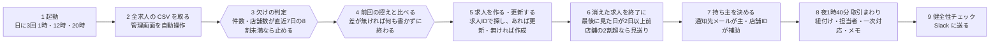
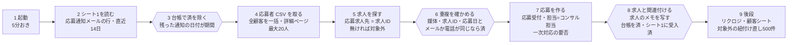

# 仕組み（処理の流れ・HubSpot の項目・覚えているもの）

2026-11-19 の読み取り調査（main 6e5e13e）をもとに作成した。どこで・いつ動くかは [01_map.md](01_map.md)、論点は [06_open_issues.md](06_open_issues.md)。
パスはすべて `scripts/job_application_sync/` の下（ワークフローは `.github/workflows/`）。

## 1. 求人の監視（HRハッカー）

二重の枠（3・4）は、その回の処理が丸ごと止まる・飛ばされる分かれ目。

| 項目 | 内容 |
|---|---|
| 何を取るか | HRハッカーの代理店の管理画面に 1 つのアカウントでログインし、全状態の求人 CSV（約 110MB）を作らせてダウンロードする。API は使わない。店舗一覧の CSV も取り、勤務地の補いに使う（失敗しても続ける） |
| 同じ求人の見分け方 | HRハッカーの求人ID（`id_hrhakkaa`）だけ。100 件ずつ HubSpot を検索し、あれば更新、無ければ作成。求人名での名寄せはしない |
| 作る・更新する項目 | 毎回上書き: 公開の状態（`kyuujin_status`）、媒体の生の値、ステージ、公開開始・終了日、同期の記録 4 項目。値があるときだけ: 求人名。空欄のときだけ: 店舗ID・勤務地。変わったときだけ: 本文・画像（HubSpot の項目の履歴が版の記録になる）。新規は「弊社管理」として作り、暗黙知のメモを付ける |
| 掲載中・終了の判断 | CSV にある求人は CSV の「公開」の値で決める（公開開始前→公開前、公開→公開中、公開終了・非公開→公開終了）。人が動かす「選考進行中」「採用決定」のステージは上書きしない。CSV から消えた求人は、最後に CSV で見た日が 2 日以上前なら公開終了（2026-10-15 から。定数は `end_vanished_listings.py` の先頭、README の表）。1 店舗の公開中の 2 割を超えるときは壊れた取得を疑って見送る |
| 変更の記録 | 専用の履歴の項目は無い。前回の値（状態・店舗ID・求人名・本文の指紋）は日ごとの控え（`hr_snapshots/`）に持つ |
| 取引との紐付け | 取込の時点では付けない。夜に、持ち主の取引先コードの生きている主契約すべてに付ける。コードが無ければ店舗IDで取引を引く。候補が別々の会社にまたがるときは付けずに人に回す。担当者は最新の生きている契約の担当者に揃える |

主なファイル: `hr_watcher.py`（差分・控え）→ `fetchers/hr_csv_fetcher.py`（CSV）→ `hr_csv_guard.py`（欠け判定）→ `hrhacker_import.py`（0-420 の作成・更新）→ `end_vanished_listings.py`、`listing_stage.py`。後段は `backfill_deal_shop_id_via_email.py`・`resolve_listing_owner.py`（`hr_owner_code`）。

## 2. 応募の登録（HRハッカー）

二重の枠は取りこぼし・二重登録の論点が集まる所（06 の論点 1〜8）。シート1の通知は「取りに行くきっかけと期間」でしかなく、応募者そのものは HRハッカーの応募者 CSV から作る。済の印は通知の行ごとに付き、応募者ごとには付かない。

| 項目 | 内容 |
|---|---|
| どこから知るか | 応募通知メールを転記した集約シートの「シート1」を直接読む（2026-07-21 から。以前のキュー用タブは止まっている）。差出人が HRハッカーなら HR。直近 14 日だけ読み、それより古い通知は開始日を指定した回収でしか読まない |
| 何を取るか | 未処理の通知の日付の最小〜最大を期間にして、管理画面から全顧客の応募者 CSV を一括で取る。詳細ページ（メモ・選考履歴・質問への回答）も 1 回 20 人まで |
| 作る項目 | パイプライン一次対応_BPO の「応募受付」。氏名・電話・メール・応募日・媒体・媒体の求人ID・属性。求人が見つかれば、求人と取引から応募先の情報・契約・一次対応の 8 項目・担当コンサルタント名を写す。見つからなければ「対象外」と「求人未特定」 |
| 関連付け | 応募→求人（typeId 5）だけ。コンタクトは作らず、取引・会社にも付けない。取引は求人から辿る |
| 担当者 | HR の応募は、今の契約（生きている主契約→オプション→全体の順で、契約開始日・作成日が最新）の取引のコンサル担当（2026-11-13、PR #22）。その人が無効なら求人の担当者。重複だった応募は空欄のときだけ埋める。紐付け直しと毎晩の合わせ込みは上書きする |
| 一次対応の要否 | 求人の既定値を入れたあと、取引の一次対応の値で上書き。応募日が 7 日より前なら外す（古い応募を架電一覧に流さないため） |
| 重複の防ぎ方 | (1) 台帳で済の通知行を除く (2) HubSpot を「媒体・求人ID・応募日・メールか電話」で検索 (3) 同じ回の中は覚えたキーで弾く (4) シート1に「受入済」を書く |
| 紐付け直し | 毎回の最後に、「対象外」の応募を新しい順に 500 件まで見て、求人が 1 件に決まれば関連付け、応募先の情報・要否・担当者を上書きする |
| 同時に走る数 | Actions では同時に 1 本。待っている起動は後から来た起動に置き換わる。開始日を指定した回収は別の列。PC では前の回が残っていれば飛ばす |

主なファイル: `applicant_sync.py`（全体・台帳・紐付け直し）→ `applicant_queue.py`（シート1）→ `fetchers/hr_applicant_fetcher.py`（応募者 CSV・詳細ページ）→ `applicant_import.py`（0-421 の作成・重複判定・担当者・要否・関連付け）、`hr_applicant_fields.py`。

## 3. 取引まわり（夜 JST 1:40）

`job_daily.yml` の `deal_hygiene` が次の順に動かす。どれか 1 つ失敗するとジョブが失敗表示になる（ほかは続ける）。

| 順 | スクリプト | 中身 |
|---|---|---|
| 1 | `backfill_deal_code_of_customer.py` | 取引先コードの補完 |
| 2 | `backfill_deal_rpo_mail.py` | 取引の管理用メールの補完 |
| 3 | `sync_deal_association.py` | 求人→取引の紐付け |
| 4 | `relink_to_latest_deal.py` | 最新の取引への付け替え |
| 5 | `sync_ichijitaiou.py` | 取引の一次対応を求人へ |
| 6 | `backfill_appointment_anmokuchi.py` | 応募への一次対応 8 項目の転記 |
| 7 | `sync_appointment_owner.py` | 応募の担当者をコンサル担当に合わせる（直近 90 日） |
| 8 | `inherit_rollup_by_contract.py` | 契約をまたぐメモの引き継ぎ |
| 9 | `sync_deal_memo_to_listing.py` | 暗黙知メモの転記 |
| 10 | `backfill_appointment_memo.py` | 応募メモの穴埋め |
| 11 | `check_sheet_url_drift.py` | 顧客シート URL の食い違いの検知 |
| 12 | `health_check.py` | 健全性チェック（未紐付け・ステージ違いを数えて Slack。要対応リストは集約シートのタブへ） |

今の契約の選び方は `deal_master.py`。GAS からも `applicant_sync.yml` の mode=deal-assoc・ichijitaiou・relink が起動される（01 の表）。報告シート URL の取引→求人の写しは `sheet_url_copy.yml`（JST 2:10）。

## 4. AirWork

| 項目 | 内容 |
|---|---|
| 動く場所 | 専用 PC（`C:\jas_dev`、PR #16 のブランチ `feat/aw-crawl-daily`）。GitHub からはログインできない（2026-10-10 から遮断） |
| 応募の取り込み | 5 分おき。1 社数秒。応募の中では求人を取りに行かない。応募の求人が HubSpot に無い社は「急ぎ取得」の待ち行列（`aw_urgent_jobs.json`）に積み、別のタスクがその社の求人だけを取る |
| 求人の巡回 | 毎晩 21:00。受注中の全社と最近応募が来た社を、最後に取れたのが古い順に回る。社ごとに 求人 → 画像の URL → 週 1 回の有料広告実績の作成。1 社ずつ、社の間を 60〜90 秒あける |
| 403 対策 | AirWork へのアクセスは PC 全体で 1 本の順番（`fetchers/aw_pace.py`）。403 を受けたら 30 分止まる。応募が巡回・課金より先に順番を取る |
| 同じ求人の鍵 | `airwork_account_login_id` + `id_airwork` |
| 取引との紐付け | ログインID → 管理用メール |
| 応募の担当者 | 求人の担当者（HR と違う。#16 は main の PR #22 より古い決め方） |
| 有料広告実績 | README の「AirWork 有料広告実績」の節（`aw_orchestrator.py` の billing、`airwork_billing_import.py`） |

PC のタスク名・ログ・env は [03_pc_operations.md](03_pc_operations.md)。

## 5. リクロジ

- 求人は作らない。HR_HR が先に「公開前」で作り（`reclogi_moto_hr_kyuujin_id` あり・`id_reclogi` 空）、`reclogi_applicants.py` が最初の応募のときにそれを採用して `id_reclogi` を書く（PR #21）。無ければ求人ページから作る。
- 応募は HR の応募の回の後段で、集約シートの「リクロジ応募」タブから作る。担当者は求人の担当者。取引は元の HR 求人の取引を写す。

## 6. 顧客シートへの写し

- HR の応募の回の後段（`customer_sheet_sync.py`）。
- 許可リスト（`CUSTOMER_SHEET_ALLOW`）にある顧客シートだけ。作成から 72 時間以内（かつ `CUSTOMER_SHEET_START` = 2026-08-04 以降）の応募を、タブ「応募一覧(自動)」に応募IDで突き合わせて追記し、HubSpot の `kokyakushiitotenkijoukyou` を「転記済」にする（対象外→未転記→転記済）。
- 書くための鍵は顧客シート専用（`CUSTOMER_SHEET_SA_JSON`）。シートごとに失敗を握って続け、失敗は毎回 Slack。
- 報告シート URL の優先順（取引 → 応募 → 求人）は HR_HR 側と `customer_sheet_sync.py` / `deal_master.py` で揃えてある。

## 7. HubSpot の対象と主な項目

| 対象 | 主な項目 |
|---|---|
| 求人 LISTING `0-420` | 同じ求人の鍵 `id_hrhakkaa`（HR）/ `airwork_account_login_id`+`id_airwork`（AW）/ `id_reclogi`。状態 `kyuujin_status`（正）、媒体の生の値 `baitai_genjoukyou_hrhakkaa`、`saishuu_csv_kenshutsu_bi`（最後に CSV で見た日）、`konkai_csv_kenshutsu_flag`、`doukisaishuujikoku`、`douki_moto_filename`、本文 `hrh_kyuujinhyou_honbun`・画像、`id_shop_hrhakkaa`、持ち主 `hr_owner_code`/`hr_owner_basis`、`kanri_kubun`、`ichijitaiounoumu_deforuto`、リクロジの元 `reclogi_moto_hr_kyuujin_id`、`customer_sheet_url`、AirWork の `airwork_weekly_perf` |
| 応募 APPOINTMENT `0-421` | パイプライン一次対応_BPO の「応募受付」で作る。`oubokyuujinmemo`（媒体の求人ID）、`yingmuri`（応募日）、氏名・電話・メール、`hr_oubosha_id`、`ichijitaiounoumu`、`kokyakushiitotenkijoukyou`、`hubspot_owner_id`、`dandangkonsarutanto`、`oubosaki_*` |
| 取引 `0-3`（納品管理パイプライン） | `consultant`（コンサル担当）、`hrhacker_shop_ids`、`itijitaiou`、`customer_sheet_url` |

## 8. 覚えているもの（台帳・処理済みの印）

どれも消さない（CLAUDE.md の決まりごと）。

| 置き場所 | 中身 | 消えたとき |
|---|---|---|
| 応募の台帳 `data/job_application_sync/applicant_ledger.json`（Actions ではキャッシュ `jas-applicant-state-v2-*`、約 10,169 件。PC では各フォルダの `data/`） | シート1の通知行ごとの状態（新規・済・失敗・見送り）、試行回数、直近のエラー。HR 詳細ページの取得状態、AirWork の失敗の記録 | 14 日分の通知が新規に戻り取り直す。重複は HubSpot の検索とシートの印で防ぐ前提 |
| 回収用の台帳（Actions の別のキャッシュ `data/job_application_sync_backfill/`） | 開始日を指定した回収の台帳。定期の回で混ぜ込む | 回収分の記録だけ失う |
| 求人の控え `hr_snapshots/`（Actions ではキャッシュ `jas-job-state-v1-*`） | 日ごとの求人の要約、欠けの通知済みの記録、HRハッカーのログイン状態 | 次の回が初回扱い。新規 500 件超なら書かずに控えだけ作って止まる |
| 健全性のスナップショット `health_check_latest.json`（Actions のキャッシュ） | 前回の健全性チェックの件数 | 前回比が出ない |
| AirWork の状態（PC の `data/job_application_sync/`） | `aw_urgent_jobs.json`（急ぎ取得）、`aw_fetch_ledger.json`（取得に成功した口座）、`aw_billing_queue.json`・`aw_billing_empty.json`（有料広告実績） | 03 を参照 |
| シート1のマーカー列 | 「受入済」。「キュー済」「済」も済とみなす（ただし読むときに済として除いてはいない。除くのは台帳） | — |
| 集約シートのリクロジのタブ | 「HubSpot登録」「HubSpot応募者ID」 | — |
| 集約シートのタブ「PC稼働」（#23 の後） | 処理ごとの最後に成功した時刻など | 03 を参照 |
| HubSpot の応募 | 顧客シートの転記の状態、一次対応の項目を写した日時 | — |

Actions のキャッシュは使われないと 7 日で消える。5 分おきに使うので、止まらない限り残る。#23 の切り替え後は Actions の台帳は動かなくなり、PC の台帳が新しく始まる（移さない。04 を参照）。

## 9. 失敗したときの扱い

| 場面 | 扱い | 知らせ |
|---|---|---|
| 応募の取込が全部失敗 | 失敗として 1・2・4…最大 24 時間あけて再試行し続ける | 3 回目で Slack |
| 応募の取込が一部だけ失敗 | 成功扱い。その期間の通知行は全部済になる | なし |
| 求人の CSV が欠けている | その回の取込と後続を止め、前回の控えを残す | 1 回の枠で 1 度 Slack |
| 求人の取込で書き込み失敗 | 控えを進めず、次の回に同じ差分をやり直す | なし（ジョブは成功表示） |
| 顧客シートの写しの失敗 | シートごとに握って続ける | 毎回 Slack |
| 取引まわり（夜） | どれか 1 つ失敗でジョブが失敗表示 | 健全性チェックの Slack |
| 専用 PC が止まる（#23 の後） | 代わりに取り込む仕組みは無い | `pc_heartbeat_watch.yml` が Slack（03） |

## 10. 媒体ごとの違い

| | HRハッカー | AirWork | リクロジ |
|---|---|---|---|
| 求人の鍵 | 求人ID | アカウント＋求人ID | リクロジの求人ID |
| 求人の取込 | 日 3 回（Actions、#23 の後は PC） | 専用 PC、毎晩 | 求人は HR_HR が作る |
| 応募の取込 | 5 分おき（同上） | 専用 PC、5 分おき | HR の応募の回の後段 |
| 応募の担当者 | 取引のコンサル担当 | 求人の担当者 | 求人の担当者 |
| 取引との紐付け | 持ち主コード → 店舗ID | ログインID → 管理用メール | 元の HR 求人の取引を写す |

共通の部品: 応募の作成（重複判定・要否・関連付け）、ステージの合わせ方、消えた求人の終了、今の契約の選び方、顧客シートの写し。HR と AirWork の同じ仕事の求人は、文面をわざと変えているので結び付けない（2026-10-09 決定）。

## 11. HR_HR との接点

- HR_HR（`makimaki1006/HR_HR`、公開リポ）の案件管理 `/app/job-copy` と CRM の応募モードが 0-420・0-421 を読む。
- HR_HR の CRM（応募モード）は `ichijitaiounoumu = 必要` と応募受付などのステージで架電一覧を作る。要否の付け方の誤りは架電一覧に直接出る。
- リクロジの求人は HR_HR が先に作る（5 節）。

## 12. ファイルの役割

| ファイル | 役割 |
|---|---|
| `.github/workflows/job_daily.yml` | 求人の取込（phase=hr）と取引まわり（deal_hygiene） |
| `.github/workflows/applicant_sync.yml` | 応募の登録（mode=sync）と relink・deal-assoc・ichijitaiou・reconcile |
| `.github/workflows/sheet_url_copy.yml` | 報告シート URL の取引→求人 |
| `gas_dispatch_trigger.gs` | GAS プロジェクト applicant-dispatch の写し |
| `hr_watcher.py` / `fetchers/hr_csv_fetcher.py` / `hr_csv_guard.py` | 求人 CSV の取得・欠けの判定・差分・控え |
| `hrhacker_import.py` / `listing_stage.py` / `end_vanished_listings.py` | 求人の作成・更新・ステージ・消えた求人の終了 |
| `resolve_listing_owner.py` / `deal_master.py` / `sync_deal_association.py` / `relink_to_latest_deal.py` | 持ち主・今の契約・取引への紐付け |
| `applicant_sync.py` / `applicant_queue.py` | 応募の回の全体・台帳・シート1・紐付け直し |
| `fetchers/hr_applicant_fetcher.py` / `hr_applicant_fields.py` | 応募者 CSV・詳細ページ |
| `applicant_import.py` | 応募の作成・重複判定・担当者・要否・関連付け |
| `customer_sheet_sync.py` | 顧客シートへの写し |
| `reclogi_applicants.py` | リクロジの求人の採用・作成と応募 |
| `sync_appointment_owner.py` / `backfill_appointment_anmokuchi.py` / `sync_ichijitaiou.py` | 毎晩の担当者・一次対応の合わせ込み |
| `health_check.py` | 毎晩の健全性チェック |
| `airwork_import.py` / `fetchers/aw_*.py` | AirWork（PC で動くのは #16 のブランチの版） |
| `pc_runner.py` / `pc_heartbeat.py` / `pc/register_hr_tasks.ps1`（#23） | 専用 PC で HR を動かす入口・稼働の記録・タスクの登録 |
