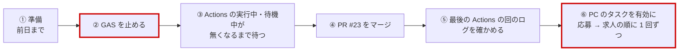

# 切り替えの手順（HR を Actions から専用 PC へ）

変更は PR #23（`feat/hr-on-local-pc`、未マージ）。決まったことは [05_decisions.md](05_decisions.md)、PC のタスク・env・ログ・戻し方は [03_pc_operations.md](03_pc_operations.md)。
この手順書に秘密値の値は書かない。値は手元の控えから入れる。

予定日時: **案** 2026-11-24（火）朝 8:00〜9:00。ユーザー未決定（[06_open_issues.md](06_open_issues.md)）。

## 範囲

| 処理 | 今 | 切り替え後 |
|---|---|---|
| HR の応募の登録 | GAS が 5 分おきに Actions を起動 | PC のタスク `\JAS\JAS_HR_applicants`（5 分おき） |
| HR の求人の監視 | Actions の cron 1:00・12:00・20:00 | PC のタスク `\JAS\JAS_HR_listings`（1:01・12:01・20:01） |
| 夜の取引まわり（1:40） | Actions | 変わらない。PC の 1:01 の回が終わるのを待たない（Actions のときも cron の着き方しだいで同じだった） |
| AirWork | PC の `C:\jas_dev` | 変わらない。触らない |
| 止まったときの知らせ | — | PC が集約シートのタブ「PC稼働」に書き、Actions が 30 分おきに読んで古ければ Slack |

Actions は予備に残さない（同時に動くと同じ応募を二重に作りうる）。



赤い枠（② と ⑥）の間、応募の登録が止まる（十数分）。③ で待つので、Actions と PC が同時に動く時間はほぼ無い。④ のあとは、GAS から起動されても Actions の HR は「スキップ」で終わる。

担当: すべて PC のセッション（2026-11-20 ユーザー決定）。GAS のトリガーの削除は PC のブラウザで行うか、ユーザーに頼む。

## 0. 準備（PC のセッション。開発用のフォルダで行う）

1. `feat/hr-on-local-pc` に main を取り込む。PR #24 と #23 が `job_daily.yml` の同じ `if:` を変えているので、両方の条件を残す:
   ```yaml
   if: >-
     github.event.schedule != '40 16 * * *' &&
     inputs.phase != 'deal-hygiene' &&
     (inputs.phase != 'hr' || vars.HR_ON_ACTIONS == '1') &&
     (!startsWith(inputs.phase, 'aw-') || vars.AW_ON_ACTIONS == '1')
   ```
   push して CI があれば通るのを見る。これで `docs/operations/` も PR #23 のブランチに入る。
2. PR #19 の扱い（`hr_reconcile.yml` は Actions で HR の応募を取り込み直すので、#23 の方針とぶつかる）: 2026-11-20 ユーザー決定「タイミングを見て切り替える」（05）。時期はユーザーが決める。それまで #19 はマージしない。切り替えはこれを待たない。
3. 顧客シート用の `CUSTOMER_SHEET_SA_JSON`・`CUSTOMER_SHEET_ALLOW`: 2026-11-20 ユーザー決定「いったん無視」（05）。用意を待たずに進める。無いまま切り替えると、PC では顧客シートへの写しが止まる（応募の登録は動く）。用意できたら `C:\jas_hr\.env` に足す。

## 1. PC の準備（前日まで、PC のセッション）

この章ではタスクを動かさないので、Actions の処理とは重ならない（試しは書き込まない）。

### 1-1. フォルダとコード

```powershell
# 文書を読むために main で作ってあればそのまま使う
git clone https://github.com/sfujimaki-art/Hubspot_Job-Posting.git C:\jas_hr
cd C:\jas_hr
git fetch origin
git checkout feat/hr-on-local-pc
```

### 1-2. Python と部品

AirWork のタスクと同じ版の Python。PC に入っているのは 3.12 だけで、AirWork の `C:\jas\venv` も 3.12.10（2026-11-20 確認。Actions は 3.10。`py -0` で入っている版が分かる）。

```powershell
cd C:\jas_hr
py -3.12 -m venv .venv
.venv\Scripts\python -m pip install --upgrade pip
.venv\Scripts\python -m pip install -r requirements.txt google-api-python-client
.venv\Scripts\python -m playwright install chromium
```

ブラウザは PC に残り、以後の回では入れない（Actions では毎回入れて 4〜11 分かかっていた）。

### 1-3. `C:\jas_hr\.env`

1. AirWork の `.env` は `C:\jas\secrets\.env`（`C:\jas_dev` には無い。03 の 3 章）。これを `C:\jas_hr\.env` に写す（`pc_runner.py` はリポ直下の `.env` を読む）。シートの鍵のファイルは `C:\jas\secrets\google_sa.json` で、`GOOGLE_SA_JSON` はこのファイルのパスを指しているので、写した行のままで HR からも読める。
2. `C:\jas_hr\.env` に `JAS_LEDGER_PATH`・`JAS_SESSION_DIR`・`JAS_LEDGER_MERGE_FROM` の行が無いことを確かめる（AirWork では起動のスクリプトが入れていて、`.env` には無い。2026-11-20 確認。あれば消す。残すと AirWork と同じ台帳を使う）。
3. 03 の 3 章の表で HR に ○ の名前が全部あるか確かめ、無いものを足す。値は書き写すだけで、画面やチャットに貼らない。`JAS_HR_SINCE` は当日に入れる（4 章）。

`JAS_HR_SINCE` を入れ忘れると、最初の回で直近 14 日分の応募者を全部取り直して重複を確かめる。重複の確認が HubSpot 側の一時的な失敗に当たると同じ応募を作るので、必ず入れる。

### 1-4. 試し（書き込まない）

```powershell
cd C:\jas_hr
.venv\Scripts\python scripts\job_application_sync\pc_runner.py applicants --dry-run
.venv\Scripts\python scripts\job_application_sync\pc_runner.py listings --dry-run
```

- 求人の方は 10〜30 分以上かかる。試しでは「控えが無いときに止まる安全装置」が効かないので、全求人（約 4 万件）を新規の差分として HubSpot と突き合わせる（読み取りだけ）。終わると求人の控えが PC に保存され、次の本番の回はこの控えとの差分から始まる。
- 試しでは「PC稼働」のタブに書かない。
- ログ `C:\jas_hr\scratchpad\pc_logs\applicants-<日付>.log`・`listings-<日付>.log` で次を見る。

| ログの行 | 見ること |
|---|---|
| `[applicant_sync] シート1直読み (cutoff=…, dry_run=True)` | cutoff が `JAS_HR_SINCE` の日（それが 14 日前より新しいとき）。まだ入れていなければ 14 日前 |
| `✅ HR: 応募取込 linked=… dup=… 範囲=…` | HRハッカーに入れて応募者 CSV が取れた。通知が無い日は出ない |
| `❌` や `Traceback` | 出ていないこと。出たら前後の行を見る（秘密値の名前が未設定と出ることが多い） |
| `[hr_watcher] 差分検出: new=…` と `[hr_watcher-done]` の `"skip_reason": "skip_aw_flag"` | 求人の CSV が取れて、差分を突き合わせた |
| `[pc_runner …] 終了: rc=0` と `結果: HR応募 成功…` / `結果: HR求人 成功 (取り込み済み)` | 各処理の最後 |

### 1-5. タスクの登録（無効のまま）

AirWork のタスクと同じ Windows のユーザーで、管理者の PowerShell を開く（右クリック →「管理者として実行」）。

```powershell
cd C:\jas_hr
powershell -ExecutionPolicy Bypass -File scripts\job_application_sync\pc\register_hr_tasks.ps1
```

タスクスケジューラの「JAS」フォルダに `JAS_HR_applicants` と `JAS_HR_listings` が「無効」で並ぶ。

### 1-6. 集約シートのタブ「PC稼働」

集約シート（`JAS_APPLICANT_QUEUE_SHEET_ID`、シート1があるもの）にタブ「PC稼働」を手で足し、3 行を入れる。PC の 2 つのタスクが同時にタブを作ろうとしてぶつからないよう、先に作る。シートへの書き込みなので、ユーザーに頼むか、ユーザーの了承を得て行う。

| A | B | C | D | E |
|---|---|---|---|---|
| 処理 | 最後に成功した時刻 | 最後の結果 | 知らせた時刻 | 最後に動いた時刻 |
| HR応募 | | | | |
| HR求人 | | | | |

B が空のままだと、見張りはその処理を「一度も成功していない」として知らせる。④ のマージから ⑥ までに知らせが来たら無視してよい。

### 1-7. 電源と再起動

03 の 6 章どおりか確かめる。

## 2. 直前の確認（当日、PC のセッション）

いちばん新しい Applicant Sync の回の「Applicant sync」の段のログで次の行を探す（01 の「状態の確かめ方」のコマンド）。

```
[applicant_sync] 台帳による除外: N件 → 0件 (DONE=N SKIP=0 FAILED上限超=0)
```

「→ 0件」で FAILED が 0 なら、直近 14 日の通知はすべて Actions で済んでいる。PC は切り替えの日より前の通知を読まないので、ここが 0 件であることが前提。0 件でなければ、数回あとの回で 0 件になるのを待つ。

## 3. 切り替え（当日）

| 順 | 誰が | 作業 |
|---|---|---|
| 1 | PC | `C:\jas_hr\.env` の `JAS_HR_SINCE` を今日の日付にする |
| 2 | PC のセッションかユーザー | GAS プロジェクト applicant-dispatch を開き、左の時計の「トリガー」で `dispatchApplicantSync` と `dispatchJobDailyHR` の行の「︙」→「トリガーを削除」。ここから Actions の HR の応募は起動されない |
| 3 | PC | Actions の画面か `gh run list` で、Applicant Sync と Job Daily に実行中・待機中（Queued / Waiting）の回が無いことを確かめる。あれば終わるまで待つ（たいてい数分） |
| 4 | PC | PR #23 をマージする。以後 Actions の HR の求人の cron も無くなり、GAS から起動されても HR は「スキップ」 |
| 5 | PC | 3 で待った最後の Applicant Sync の回のログで、`台帳による除外: … → 0件 (… FAILED上限超=0)`、または同じ回に `✅ HR: 応募取込 … 範囲=今日〜今日` があり `❌ HR:` / `⏳ HR:` が無いことを確かめる（残りは今日の通知だけで、PC が拾う）。前日以前の通知が失敗で残っていたら、PC で `pc_runner.py applicants -- --hr-cutoff <取り残された日>` を 1 回流すか、ユーザーに相談する |
| 6 | PC | コードを main にそろえる: `cd C:\jas_hr` → `git checkout main` → `git pull` |
| 7 | PC | 応募のタスクを有効にして 1 回動かす（下のコマンド）。最初の回はリクロジのタブの過去の行も見直すので少し長い。3〜5 分後にログを見る（03 の 4 章） |
| 8 | PC | 求人のタスクを有効にして 1 回動かす。1-4 の試しで控えができていれば差分を取り込む本番の回になる。控えが無ければ HubSpot に書かずに控えだけ作って止まる（結果は「成功 (初回の控え作り)」。次の 12:01 か 20:01 から本番） |
| 9 | PC | タブ「PC稼働」の HR応募・HR求人の B 列に時刻が入ったことを確かめる |

```powershell
Enable-ScheduledTask -TaskPath "\JAS\" -TaskName JAS_HR_applicants
Start-ScheduledTask  -TaskPath "\JAS\" -TaskName JAS_HR_applicants
# ログを見てから
Enable-ScheduledTask -TaskPath "\JAS\" -TaskName JAS_HR_listings
Start-ScheduledTask  -TaskPath "\JAS\" -TaskName JAS_HR_listings
```

終わったら、05 に実施の日時を、01 の「今の状態」を切り替え後の表に合わせて直す PR を出す（PC のセッション）。

## 4. 翌日の確かめ方

- タブ「PC稼働」: HR応募の B 列が 5〜10 分以内、HR求人の B 列が直近の 1:01・12:01・20:01 の回のどれか。C 列に「失敗」が続いていない。
- Slack: 「専用PCの … 成功していません」が来ていない。
- Actions: Job Daily は 1:40 の取引まわりだけが動いて成功。PC Heartbeat Watch が 30 分おきに成功。
- PC のログ `applicants-<日付>.log`: `❌` が無い。`✅ HR:` の `dup=` がふだんの数（数十）で急に増えていない。
- HR_HR の CRM の応募モードに今日の HR の応募が入っている（シート1の今日の HR の通知と数を見比べる）。
- 14 日たったら `.env` の `JAS_HR_SINCE` の行は消してよい（残しても効かない）。

## 5. 止まったとき・戻すとき

03 の 5 章（止まったとき）と 7 章（戻し方）。

## 6. 残る危険

| 危険 | 大きさ |
|---|---|
| 二重登録（Actions と PC が同時に動く） | 3 章の 3 で待てばほぼ無い。マージ前に始まった Actions の回だけが残りうる |
| 二重登録（PC の最初の回） | `JAS_HR_SINCE` を入れれば、最初の回が確かめるのは当日の応募者だけで、Actions がふだん毎回していることと同じ。入れ忘れると 14 日分 |
| 応募の登録が止まる時間（切り替え） | GAS を止めてから PC の有効化まで、十数分 |
| 応募の登録が止まる時間（PC の故障・停電） | PC が戻るまで。知らせは最後の成功から 30 分〜1 時間後。予備は無い（決定どおり） |
| 求人の監視の遅れ | 控えが無いまま始めた場合、最初の本番が次の時刻（12:01 か 20:01）になる。その間の変化は次の回でまとめて入る |
| 戻したとき | `JAS_HR_SINCE` を入れ忘れると、切り替えの日〜戻す日（最大 14 日）を取り直す |
| PR #19（未マージ）の照合 | マージすると Actions と PC が両方取り込む形になる。マージ前に PC で動かす形に直すか外す |
